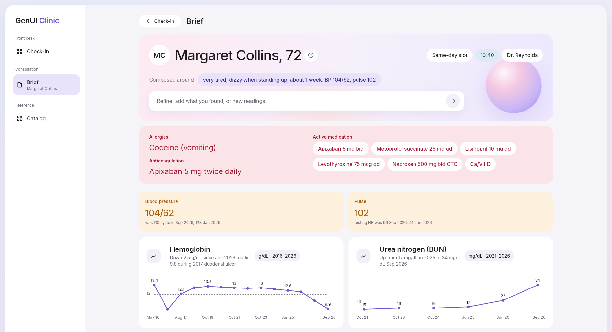
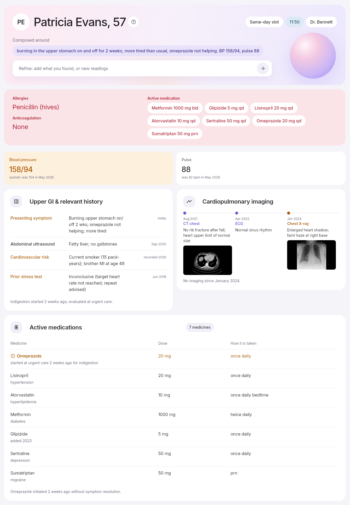
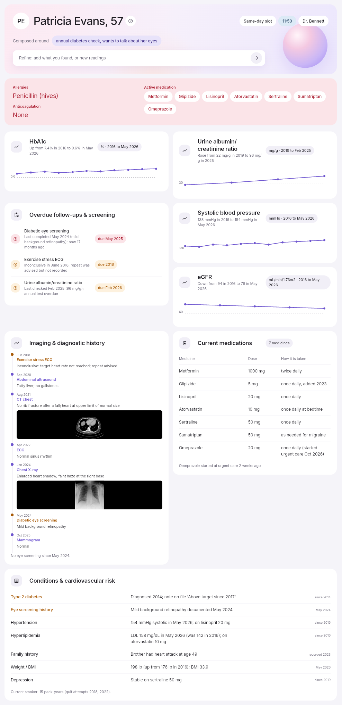
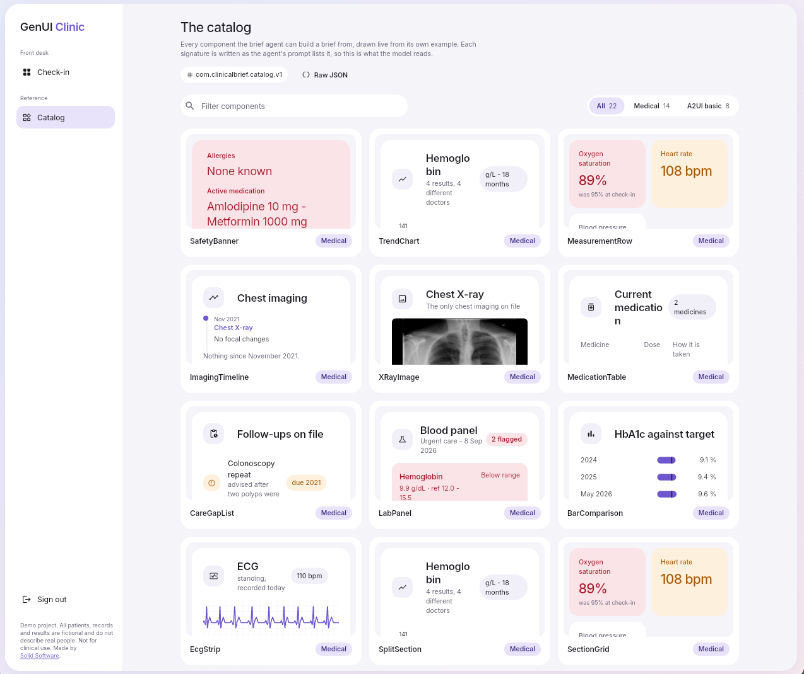
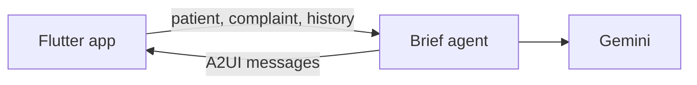

# GenUI Clinic

**A clinical dashboard that designs itself for each consultation.**

A doctor picks a patient and types why they came in. Gemini then composes a brief for that visit out of a catalog of clinical components, which [GenUI](https://pub.dev/packages/genui) renders.

**[Try the live demo →](https://genui-clinic.solid.software/)**



## The idea

The record stays the same; only what matters today changes. The model decides which components to show and in what order. The app alone controls how they look.

| First brief | Second brief |
:--:|:--:
 | 

## The catalog

The briefs are built from a custom [A2UI](https://a2ui.org) catalog of clinical components.
Every component can be browsed in the app's catalog view.



## How it works



- The **app** (Flutter web) sends the consultation and renders the reply with GenUI.
- The **brief agent** (a Dart Cloud Function on the [A2UI agent SDK](https://github.com/a2ui-project/a2ui/tree/main/dart/a2ui_agent)) asks Gemini for a brief and returns validated A2UI.
- The agent is stateless: the app sends the full consultation each turn.

## The repository

```
app/            the Flutter app and its component catalog
brief_agent/    the brief agent (Dart Cloud Function)
firebase.json   firebase config
.github/        CI: builds the app and deploys it to Hosting
```

Each program has its own README, with how to run, build, and deploy it:
- **[app/README.md](app/README.md)** — set up and run the app, its
  architecture, the catalog.
- **[brief_agent/README.md](brief_agent/README.md)** — how the agent works
  and how to deploy it.


## Deploying

- Merging to `main` deploys the app to https://genui-clinic.solid.software/.
- The agent is deployed by hand before any app version that needs it. See [brief_agent/README.md](brief_agent/README.md).

## Solid Software

<div align="center">
  <a href="https://solid.software">
    
  </a>
</div>

Developed by **[Solid Software](https://solid.software)** - a top Flutter agency and official Flutter consultants focused on high-quality software engineering.

### Why Solid Software?

- Working with Flutter since 2018 - early adopters and experts.
- AI Development and Integration: modern AI-driven development workflows that accelerate time-to-market while ensuring clean, reliable code.
- Full-cycle delivery & team augmentation.

<div align="center">
  <br />

  [💬 Hire Us](https://solid.software/#solid-footer)
</div>
